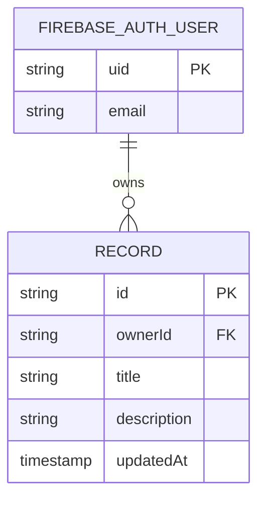

# Initial Firestore ERD

The generic starter uses one records collection. Replace this model with the approved product domain's ERD if the Figma/project brief defines different entities.

## Collection contract
- Collection: records
- Document ID: generated UUID.
- ownerId: Firebase Authentication UID; required and immutable by security rule.
- title: non-empty string.
- description: string.
- updatedAt: Firestore server timestamp.

The query filters by ownerId. Create any composite indexes requested by Firebase and document them here.
